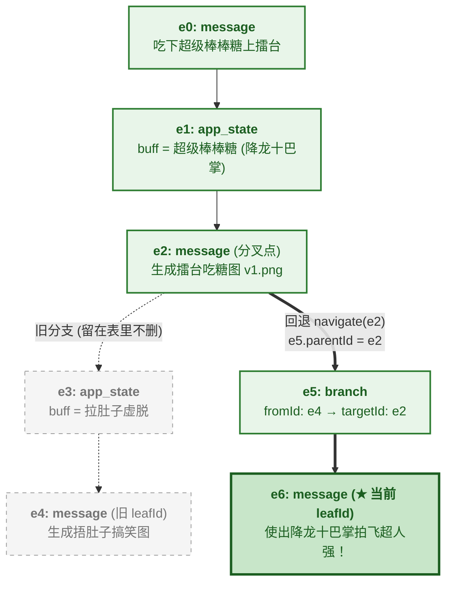
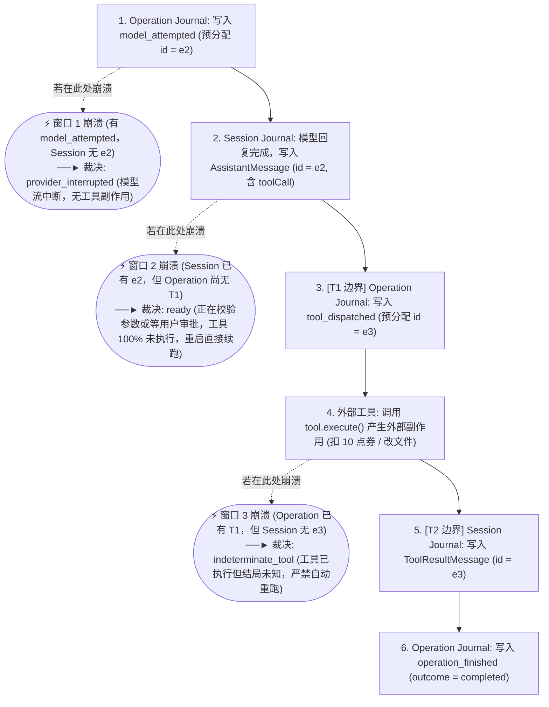
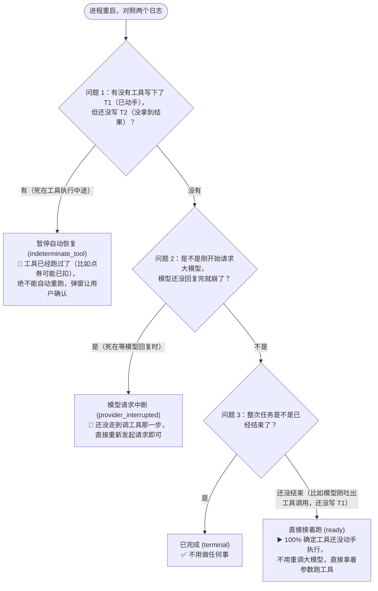

> 自己动手构建 Agent · 第 4 章 · 上一章：[工具安全执行：权限审批、Bash AST 分析与进程管控](/blog/how-to-build-your-own-agent-project/tool-safety-permissions/)


在前三章里，我们沿着一条主线搭起了 Agent 的执行骨架：用 `packages/ai` 抹平模型协议差异，用 `agentLoop` 驱动多轮工具调用，再加上上下文压缩（Compaction）与权限拦截。

如果只跑一次性、短平快的任务，把状态放在一个内存数组里就够了。但在真实的业务里，为什么一个 Agent 会冒出那么多状态，最后还特别容易乱套？

我们不妨抛开抽象的技术名词，从头开发一个**“猪猪侠动画分镜生图 Agent”**（帮用户保持统一的角色状态，连续生成一集猪猪侠大战超人强的漫画分镜），看看那些状态是怎么一步步长出来的：

1. **最早只有“聊天记录（`messages`）”**：
   第 1 轮用户说：“画一张猪猪侠在武林大会擂台上对决超人强，掏出超级棒棒糖吃下！” Agent 调生图工具画出了第 1 格分镜。
2. **接着冒出了“角色当前状态面板（`appState`）”**：
   画连载分镜必须保证角色状态一致，用户不可能每画一格都重新描述一遍猪猪侠现在的 Buff 和招式。于是你在侧边栏做了一个“当前角色状态”面板 `appState`，第 1 轮吃完超级棒棒糖后，自动记下了 `{ buff: "超级棒棒糖（功夫大师状态）", skill: "降龙十巴掌" }`。
   到了第 2 轮，用户突然想整活：“先别正经打，画一格搞笑支线：迷糊老师不小心把棒棒糖拿错了，给猪猪侠吃了一颗**过期泻药丸**！” Agent 顺手把 `appState` 更新成了 `{ buff: "拉肚子虚脱（捂肚子冒冷汗）", skill: "无" }`，并画了一张猪猪侠捂肚子蹲在地上的搞笑图。
3. **聊久了又冒出“上下文压缩摘要（`compaction`）”**：
   连续画了 20 格分镜后，历史消息快把上下文窗口塞满了，系统触发了一次压缩，生成了一段前 15 轮的剧情摘要 `summary`。
4. **调外部生图 API 时还有“正在执行中的扣费任务（`operation`）”**：
   调一次外部算力接口渲染一张高清大图需要 15 秒，并且要扣掉用户账户里的 **10 个点券**。

平时顺风顺水时，把 `messages` 放聊天表、把角色状态 `appState` 放配置表、把 `summary` 放缓存里，看起来一点问题都没有。可一旦遇到下面这两个真实操作，这几处各存各的状态就会当场打架：

- **事故 1（用户点“回退 Rewind”导致状态严重穿帮）**：
  用户在第 2 轮笑完了那张拉肚子支线图，点击界面上的“回退到第 1 轮（刚吃下超级棒棒糖那一刻）”，输入：“使出绝招降龙十巴掌，一掌拍飞超人强！”
  如果你的代码只是把聊天表里第 2 轮的过期药丸消息 `DELETE` 掉，却忘了另一张表里的 `appState` 还停留在刚才改过的“拉肚子虚脱（捂肚子冒冷汗）”——结果画出来的绝招大图里，**猪猪侠一边大喊“降龙十巴掌”，一边满头冷汗捂着肚子蹲在擂台角，被超人强一拳揍飞！** 这就是典型的**“消息退回去了，但业务状态没跟着退回去”的状态撕裂**。
- **事故 2（生图半路闪退，重启后被扣了两次点券）**：
  在渲染决战大图时，模型发出了工具调用 `generate_image(prompt="猪猪侠决战超人强", cost=10)`。请求刚发给算力服务器、10 个点券已经扣了、图也渲染好了，就在准备把图片结果写进本地数据库的前一秒，进程突然断电或闪退了。
  等重启恢复时，程序一看聊天表：最后一条是模型说要调 `generate_image`，后面没有图片结果。如果程序傻乎乎地自动重跑一次 `generate_image`，**用户的 10 个点券就被白白扣了两次**！

我在之前的博客 [《能执行任务，离能自我进化还有多远？重新理解 Agent 架构设计》](https://jayden0.com/blog/agent-runtime-loops-and-evolution/) 中专门梳理过这个问题。之所以会出现“回退时状态撕裂”和“崩溃后不敢恢复”，是因为把 Runtime 设计中两个原本独立的问题搅在了一起：
1. **动作由谁驱动（控制流调度）**：是靠一个中心过程式函数（如第 01 章的 `agentLoop`）按步骤串行调度，还是靠显式状态图（如 LangGraph 的 `StateGraph`）或声明式协调器（如 Tardigrade 的 `Work = f(state)` Reconciler）自发流转？
2. **状态从何而来（事实来源）**：是以四处散落的可变内存快照为准，还是以**不可变的追加事件日志（Append-Only Journal）**作为唯一事实来源，所有运行时状态都通过纯函数从日志中折叠（Fold / Reduce）出来？

这两个维度完全可以分开选型。在控制流上，我们选择了最直观、最好调试的**过程式主循环**；但在状态管理上，我们吸收了 **DeepSeek Harness**（以不可变 Session Log 为唯一来源，通过 `deriveMessages()` 纯函数投影上下文）、**Tardigrade** 以及 **Pi v2（`harness-v2` 分支）** 的核心思想，采用**“日志驱动状态（事件溯源 / Event Sourcing）”**：

> 在 `jai-mono` 中，只有追加写入的 Journal 日志是唯一的持久化事实来源，而模型看到的 `messages`、当前的会话状态 `appState`、乃至崩溃重启后的恢复动作，全都是从日志里用纯函数算出来的投影（Projection）。

具体到代码实现上，我们在 [packages/agent/src/harness/session](https://github.com/jiahao-jayden/jai-mono/tree/main/packages/agent/src/harness/session) 和 [packages/agent/src/harness/operations](https://github.com/jiahao-jayden/jai-mono/tree/main/packages/agent/src/harness/operations) 中把持久化拆成了两个模块：
- **Session Journal（会话树日志）**：记录已经完成的对话结果、压缩条目与状态变更，解决“无损分支回退（Navigate / Fork）”与“状态同步折叠”；
- **Operation Journal（操作执行日志）**：记录单次运行内部的模型请求尝试与工具执行的“动手前 / 完成后”两个时间点，解决进程崩溃重启时的安全恢复。

下面我们依次拆解这两个模块的设计与实现。

---

## 一、 状态从何而来：树形 Session Journal 与分支回退

回到开头那个“猪猪侠分镜 Agent”的例子：为什么我们的会话历史不能存成一个简单的线性列表，而必须是一棵**树（Tree）**？
- 一方面，如果用户从第 2 轮（迷糊老师给错过期药丸的搞笑支线）回退到第 1 轮（刚吃下真超级棒棒糖）画完主线决战，随后又想把刚才那张捂肚子搞笑图找回来当彩蛋，如果底层在做回退时直接用 `DELETE` 把第 2 轮的数据删掉了，搞笑支线就彻底丢了；
- 另一方面，猪猪侠的状态 `appState`（`{ buff: "超级棒棒糖（功夫大师）" }` $\rightarrow$ `{ buff: "拉肚子虚脱（捂肚子冒冷汗）" }`）是跟着对话轮次变化的，如果把它放在树外的独立表里，回退消息时角色状态就退不回去。

### 1. 四种树节点与单根父子链 (`session/types.ts`)

为了让对话历史、上下文压缩、业务状态（如角色 Buff 或权限模式）和分支跳转全都服从同一套回退规则，[`packages/agent/src/harness/session/types.ts`](https://github.com/jiahao-jayden/jai-mono/tree/main/packages/agent/src/harness/session/types.ts) 把所有会话变更统一建模为带有 `id` 和 `parentId` 的树节点（`TreeEntry`）：

```ts
interface TreeEntryBase {
  id: string;
  parentId: string | null; // 根节点为 null，其余节点指向前驱节点 id
  timestamp: string;
}

export type TreeEntry<TAppState extends JsonObject = JsonObject> =
  | MessageEntry            // 1. 对话消息 (user / assistant / toolResult)
  | AppStateEntry<TAppState>// 2. 会话级业务状态变更 (如角色状态、权限模式、扩展状态)
  | CompactionEntry         // 3. 上下文压缩记录 (summary + firstKeptEntryId)
  | BranchEntry;            // 4. 分支导航标记 (记录从哪个旧 leafId 切过来的)
```

整棵树以只追加（Append-Only）的方式存放在 `entries` 数组中，并用一个指针 `leafId` 指向当前活跃分支的最后一条记录。

为了看懂“不删数据怎么实现回退”，我们直接看 `entries` 数组里每一行记录的 `id` 和 **`parentId`（我的上一条是谁）** 是怎么填的：

| 行号 | 编号 (`id`) | 上一条是谁 (`parentId`) | 类型 (`type`) | 记录内容 |
| :--- | :--- | :--- | :--- | :--- |
| 1 | **`e0`** | `null`（起点） | `message` | 用户说：“吃下超级棒棒糖上擂台对决超人强” |
| 2 | **`e1`** | **`e0`** | `app_state` | 状态更新：`{ buff: "超级棒棒糖（功夫大师）", skill: "降龙十巴掌" }` |
| 3 | **`e2`** | **`e1`** | `message` | Agent 画好了：`擂台吃糖分镜 v1.png` **（👈 稍后要回退到这里）** |
| 4 | *(e3)* | *(e2)* | *(app_state)* | *(旧分支：迷糊老师拿错药，状态改成 `拉肚子虚脱（捂肚子冒冷汗）`，留在表里不删)* |
| 5 | *(e4)* | *(e3)* | *(message)* | *(旧分支：Agent 画好了 `捂肚子搞笑图.png`，原 `leafId = e4`)* |
| 6 | **`e5`** | **`e2`（👈 关键：直接认 `e2` 当上一条！）** | `branch` | 用户点“回退到 `e2`”：追加一条分支记录，`parentId` 直接填 `e2` |
| 7 | **`e6`** | **`e5`** | `message` | 用户在新分支说：“使出降龙十巴掌拍飞超人强！”（新 `leafId = e6`） |

配合下面这张竖向展开的树结构图看（绿色实线是回退后的当前活跃路径，灰色虚线是留在表里未删除的旧分支），第 6 行的 `e5` 做的唯一一件事，就是**从 `e2` 分叉出来，把自己的 `parentId` 填成了 `e2`（而不是 `e4`）**：



### 2. 顺着 `parentId` 往上找：为什么 `e3` 和 `e4` 没删却自动消失了？ (`tree.ts` & `snapshot.ts`)

现在表里有 7 行数据，当前指针停在最新的 **`leafId = e6`**。当我们要拼装发给大模型的上下文、或者计算猪猪侠当前的状态时，调用 [`tree.ts`](https://github.com/jiahao-jayden/jai-mono/tree/main/packages/agent/src/harness/session/tree.ts) 里的 `branchOf(entries, "e6")`。

它的规则非常简单——**从当前的 `leafId`（`e6`）出发，顺着 `parentId` 一步步往上找，直到起点 `null`**：
1. 从 **`e6`** 出发，看它的 `parentId` 是谁？是 **`e5`**；
2. 跳到 **`e5`**，看它的 `parentId` 是谁？**是 `e2`！（注意：这里一步直接跨过了第 4、5 行的 `e3` 和 `e4`！）**
3. 跳到 **`e2`**，看它的 `parentId` 是 **`e1`** $\rightarrow$ 再跳到 **`e1`**，它的 `parentId` 是 **`e0`**。

把找到的节点倒过来排好，当前分支的完整链条就是：**`e0 → e1 → e2 → e5 → e6`**：

```ts
export function branchOf<TAppState extends JsonObject>(
  entries: readonly SessionEntry<TAppState>[],
  leafId: string | null,
): TreeEntry<TAppState>[] {
  if (leafId === null) return [];
  const byId = new Map(entries.map((entry) => [entry.id, entry]));

  const branch: TreeEntry<TAppState>[] = [];
  let cursor: string | null = leafId;
  while (cursor !== null) {
    const entry = byId.get(cursor);
    if (!entry) throw new BrokenSessionTree({ /* ... */ });
    branch.push(entry);
    cursor = entry.parentId; // 顺着 parentId 一步步往回找
  }
  return branch.reverse();
}
```

你看这条找出来的链条 `e0 → e1 → e2 → e5 → e6`：
- **旧消息自动隔离**：第 4、5 行的 `e3`（拉肚子虚脱）和 `e4`（捂肚子搞笑图）虽然还完好无损地躺在数据库里，但因为顺着 `e6` 的 `parentId` 往上找根本不会路过它们，所以它们自动从当前分支里消失了（如果用户日后想找回搞笑支线当彩蛋，只需再指向 `e4` 即可找回）。
- **角色状态 `appState` 按需写入、沿路径自动继承与回退（`applyEntry` & `branchAppState`）**：
  你可能会好奇：**难道每次新建一个分支，都要专门复制写一条 `app_state` 节点吗？**
  完全不需要。`app_state` 节点只有在业务状态**真正发生修改时**才会往树上追加；如果连续聊了 10 轮都没改过状态，树上就只有普通的 `message` 节点。
  那么当用户在第 6 行追加 `e5` 回退分支（注意：`e5 → e6` 这条新树枝上自己并没有写 `app_state`）时，系统是怎么知道当前状态的？看 [`snapshot.ts`](https://github.com/jiahao-jayden/jai-mono/tree/main/packages/agent/src/harness/session/snapshot.ts) 里的 `applyEntry` 和 `branchAppState`，一共不到 15 行代码：

```ts
export function applyEntry<T extends JsonObject>(
  snapshot: SessionSnapshot<T>,
  entry: SessionEntry<T>,
): SessionSnapshot<T> {
  const entries = [...snapshot.entries, entry];
  const next: SessionSnapshot<T> = { ...snapshot, entries, leafId: entry.id, updatedAt: entry.timestamp };
  if (entry.type === "app_state") return { ...next, appState: cloneJson(entry.value) };

  // 如果新节点的 parentId 不等于刚才的 leafId，说明发生了跨分支回退，沿新分支链条从头重算 appState
  return entry.parentId === snapshot.leafId
    ? next
    : { ...next, appState: branchAppState(entries, entry.id, snapshot.initialAppState) };
}

function branchAppState<T extends JsonObject>(entries: readonly SessionEntry<T>[], leafId: string, initial: T): T {
  let appState = initial; // 从创建会话时的初始状态出发
  // 沿着从根到当前 leafId 的路径走一遍，路上遇到的最后一个 app_state 节点就是当前生效的状态
  for (const entry of branchOf(entries, leafId)) if (entry.type === "app_state") appState = entry.value;
  return cloneJson(appState);
}
```

你看 `branchAppState` 的逻辑：它从会话最初的默认值 `initialAppState` 出发，沿着新分支路径 `e0 → e1 → e2 → e5 → e6` 从头往后走，路上遇到的最后一个 `app_state` 节点就是第 2 行的祖先节点 `e1`（超级棒棒糖 + 降龙十巴掌），而旁支第 4 行的 `e3`（拉肚子虚脱）根本不在这条路上。所以新分支哪怕自己没写 `app_state`，也自动继承并恢复成了 `e1` 的超级棒棒糖状态！

---

## 二、 崩溃恢复的难题：怎么知道工具在闪退前跑没跑过？

Session Journal 管好了“已经完成的历史记录”。但如果 Agent 正在运行途中，宿主进程突然闪退、断电或被强制杀死，光靠 Session Journal 是没法安全恢复的。

回到开头猪猪侠生图的第 2 个事故：
模型发出了工具调用 `generate_image(prompt="猪猪侠决战超人强", cost=10)`，这条模型的回复已经写进 Session Journal 了。结果就在下一秒，进程崩溃了。
等进程重启后打开数据库一看：只有模型的 `generate_image` 调用，后面没有对应的 `ToolResultMessage`（图片结果）。

这时候系统面临一个致命的二选一：
- **情况 A（工具其实还没跑）**：崩溃发生时，系统还在做参数校验，或者正停在弹窗上等用户确认“是否消耗 10 点券生图”。此时算力服务器根本没收到请求，点券也没扣。**重启后应该直接接着跑这个工具。**
- **情况 B（工具其实已经跑了）**：用户已经点了同意，请求已经发给算力服务器把 10 点券扣了，只是在拿到结果写回本地数据库的前一秒崩了。**重启后绝不能再自动重跑一次，否则用户会被扣两次钱！**

在分布式系统里，当进程在执行外部操作的中途崩溃时，客观上存在下面四种情况：

| 崩溃发生的时间点 | 外部世界的真实状态 | 重启后的正确恢复策略 |
| :--- | :--- | :--- |
| **1. 模型回复已落盘，但工具还没开始执行（情况 A）** | 外部工具尚未收到任何调用，零副作用 | **安全续跑**：直接拿着已落盘的工具参数继续执行，无需重调模型 |
| **2. 模型流式请求发出一半崩溃** | 模型回复未完成，尚未进入工具阶段 | **安全重试**：丢弃半截请求，重新发起模型推理 |
| **3. 工具已开始执行，但结果写入前崩溃（外部支持对账/幂等）** | 外部操作可能成功也可能失败 | **对账或幂等重试**：通过业务单号查询外部状态或带 `Idempotency-Key` 重试 |
| **4. 工具已开始执行，但结果写入前崩溃（情况 B：非幂等工具）** | 点券可能已扣、文件可能已改、Shell 可能已跑完 | **挂起等待确认（禁止自动重跑）**：标为结果未知状态，交由宿主/用户确认 |

问题来了：**如果我们在代码里只在工具跑完之后才写数据库，重启时系统怎么区分自己死在“情况 1（还没动手）”还是“情况 4（已经动手了但没写完结果）”？**

答案很简单：只在工具跑完后记一次账是不够的，必须在**“工具真正动手执行的前一刻”**和**“工具执行完拿到结果后”**分两次记账。在源码注释里，我们把这两个记账时间点简称为 **T1** 和 **T2**：
- **T1（动手前先记一笔：`tool_dispatched`）**：当工具通过了参数校验和权限审批、**即将调用 `tool.execute()` 的前一毫秒**，先往执行日志（Operation Journal）里写一条 `tool_dispatched` 记录（意思是：“我马上要动手跑这个工具了，并且提前分配好将来存结果的编号 `resultEntryId = e3`”）。
- **T2（拿到结果再记一笔：`ToolResultMessage`）**：等 `tool.execute()` 跑完返回结果后，把结果（使用刚才提前分配好的编号 `id = e3`）写进会话日志（Session Journal）。

下面这张时序图展示了从用户发起请求、模型返回工具调用，到工具落盘的完整过程，以及**在不同时间窗口发生崩溃时，两个日志里留下的证据差异**：



看 [`operations/types.ts`](https://github.com/jiahao-jayden/jai-mono/tree/main/packages/agent/src/harness/operations/types.ts) 里 `OperationRecord` 的定义，它只记录极简的执行事实，绝不重复存储消息正文：

```ts
export type OperationRecord =
  | OperationAccepted   // 1. 接收操作 (绑定输入消息 inputEntryId)
  | ModelAttempted      // 2. 发起模型请求前：预分配 assistantEntryId
  | UsageSettled        // 3. 模型请求返回：记录 Token 消耗账单
  | ToolDispatched      // 4. T1 边界：工具通过审批、真正执行前，记录参数哈希并预分配 resultEntryId
  | InputQueued         // 5. 运行中途收到的 Steering / Follow-up 排队输入
  | OperationFinished;  // 6. 整次操作正常收尾 (completed / failed / aborted / ...)
```

注意这里的设计技巧：**预分配 ID（Preallocated Entry ID）**。
- 在发起模型请求前，先写一条 `model_attempted`，提前生成好将来那条回复在 Session Journal 里的 ID `assistantEntryId`；
- 在工具通过了 `permissionMiddleware` 审批、即将调用 `tool.execute()` 的前一刻，先写一条 **`tool_dispatched`（T1）**，提前生成好将来那条工具结果在 Session Journal 里的 ID `resultEntryId`；
- 等工具跑完发出 `message_end` 事件时，直接拿着这个预分配的 `resultEntryId` 写入 Session Journal（**T2**）。

这样一来，Operation Journal 和 Session Journal 就通过预分配的 `assistantEntryId` 和 `resultEntryId` 关联在了一起。

---

## 三、 重启后怎么根据日志决定下一步？(`recoverOperation`)

有了上面这两个日志，当进程闪退重启时，怎么知道刚才停在哪一步了？

其实根本不需要复杂的逻辑，只要把两边日志里的记录对照一下，问自己 **3 个问题** 就行了（代码位于 [`packages/agent/src/harness/operations/recovery.ts`](https://github.com/jiahao-jayden/jai-mono/tree/main/packages/agent/src/harness/operations/recovery.ts)）：



写成代码，其实就是下面这 4 个简单的 `if` 判断：

```ts
export function recoverOperation(records: readonly OperationRecord[], evidence: OperationRecoveryEvidence) {
  // 1. 有 T1 (已动手)，但没有 T2 (没结果) -> 结局未知，暂停自动恢复！
  const incomplete = dispatches.filter((d) => !evidence.sessionEntryIds.has(d.resultEntryId));
  if (incomplete.length > 0) {
    return Result.ok({ status: "indeterminate_tool", /* ... */ });
  }

  // 2. 已经写过结束标记 -> 任务已结束
  if (terminal) {
    return Result.ok({ status: "terminal", /* ... */ });
  }

  // 3. 发起了模型请求，但模型回复还没落盘 -> 模型请求半路中断
  const latestAttempt = [...attempts.values()].at(-1);
  if (latestAttempt && !evidence.sessionEntryIds.has(latestAttempt.assistantEntryId)) {
    return Result.ok({ status: "provider_interrupted", /* ... */ });
  }

  // 4. 其余情况（比如模型已返回工具调用，但还没写 T1）-> 安全接着往下跑
  return Result.ok({ status: "ready", /* ... */ });
}
```

把这 4 个分支套回开头猪猪侠生图扣 10 点券的场景里，结果就一目了然了：
- 如果闪退发生在**用户还没点同意、或者刚准备调生图接口之前（还没写 T1）** $\rightarrow$ 落入第 4 种情况（`ready`），重启后不用再问一遍大模型，直接接着执行生图；
- 如果闪退发生在**已经向生图服务器发出了请求之后（写了 T1，还没写 T2）** $\rightarrow$ 落入第 1 种情况（`indeterminate_tool`），系统立刻刹住车，不会自作聪明去重跑第二次导致重复扣费。

> **可能你会问：对于第二种情况（写了 T1 却没写 T2），难道在工程上就没有能自动解决的方案，非要停下来询问用户吗？**
>
> 其实这取决于**框架与下游工具能不能配合实现“端到端幂等”**。
>
> 在我之前那篇文章里专门介绍过 **Tardigrade**（以及像 **Temporal、Restate** 这类持久化执行框架），它们处理外部副作用的思路非常值得借鉴——**为每个副作用生成跨崩溃不变的确定性幂等键（Deterministic Durable Key）**：
> 1. **在框架侧生成确定性 Key**：
>    在 Tardigrade 的 `Work = f(state)` 模型里，状态机派生出的每一个待执行动作（Transition）都带有一个由状态唯一决定的 `key`（比如 `pay-${bookingIntent.id}`，并且在源码里区分了记录重试次数的物理序号 `ordinal` 和跨重试保持不变的逻辑幂等键 `attempt`）。这对应到我们的 T1 记录里，就是那对已经持久化落盘的 `toolCallId` 和 `resultEntryId`。
> 2. **把 Key 作为 `Idempotency-Key` 传给下游，实现全自动恢复**：
>    回到猪猪侠生图扣 10 点券的例子：如果在调用生图接口时，我们直接把 T1 记录里的 `toolCallId` 作为 `Idempotency-Key` 传给算力服务器。那么就算进程在扣完点券、拿到图片的前一秒闪退了，重启后系统带着**同一个 `toolCallId`** 自动重发一次请求，算力服务器一查这个 Key 已经扣过费、画好图了，就不会再扣第二次钱，而是直接把上次生成的图片原样返回！这样根本不需要弹窗问用户，就能全自动无损恢复（纯只读工具如 `Read` / `Grep` 同理，因为天然幂等，也可以直接重跑）。
> 3. **那为什么 `jai-mono` 内核还是要保留 `indeterminate_tool` 状态？**
>    因为“靠幂等键自动重试”有一个前提：**下游工具得认这个 Key**。我们自己写的远程 API、支付网关都认幂等键；但在本地 Coding Agent 里，最常调的工具是 **`Bash`（任意 Shell 命令）**。当你让操作系统的 `/bin/sh` 去跑一句 `./deploy.sh` 时，Shell 可不支持什么 `Idempotency-Key`。因此内核层的 `recoverOperation` 先诚实地把这种“有 T1 无 T2”的情况标为 `indeterminate_tool` 刹住车，再由上层宿主根据工具类型分别处理：支持幂等键或只读的工具直接自动恢复，不支持幂等的本地黑盒脚本再交由用户确认。
---

## 小结

回看这一章的持久化与恢复设计，核心其实就是把**“日志作为唯一事实来源”**贯彻到底：
- **对内（会话历史与状态）**：用一棵只追加的树（`SessionEntry`）把消息、压缩记录、分支跳转和 `appState` 串在同一条父子链上。回退分支（`navigate`）不删任何历史数据，只靠移动 `leafId` 和纯函数折叠（`branchOf` + `applyEntry`），就实现了消息与业务状态的同步回退；
- **对外（物理世界副作用）**：承认本地日志无法替代外部物理事实，用 `Operation Journal` 在工具执行前后划出 **T1（意图落盘）** 和 **T2（结果落盘）** 两道边界，再通过纯函数 `recoverOperation` 判断状态：没过 T1 的无损续跑，过了 T1 没到 T2 的标为 `indeterminate_tool` 禁止盲目重放。

到这里，Agent 的核心底座已经搭起来了。但你会发现一个有意思的事：我们的核心循环里只写了 `Read`、`Edit`、`Bash` 这几个基础工具，那用户日常离不开的 **Todo 任务面板、Subagent 子智能体派发、Web Search 联网搜索、Skills 技能包、乃至 MCP 协议接入和斜杠命令（`/command`）**，全都不在核心代码里！

如果每加一个新功能都往核心循环里塞一套逻辑，代码库不用一个月就会变成改不动的大泥球。在 `jai-mono` 里，上面所有这些核心能力，全都是通过一套统一的 **`Extension`（扩展系统）** 挂载上去的——甚至连它的状态回退，都直接白嫖了我们这一章刚建好的 Session Tree！

下一章，我们就来看看这套几乎能把所有产品功能都做成插件的 `Extension` 架构是怎么设计的。

---

上一篇：[第 3 章：工具安全执行：权限审批、Bash AST 分析与进程管控](/blog/how-to-build-your-own-agent-project/tool-safety-permissions/)

下一篇：[第 5 章：能力扩展：从直接修改核心代码到统一的 Extension 架构](/blog/how-to-build-your-own-agent-project/extension-system/)
