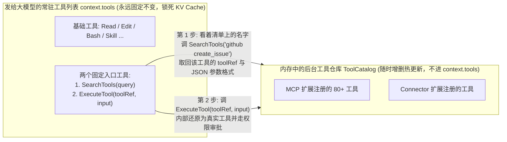

# 能力扩展：从直接修改核心代码到统一的 Extension 架构 (`packages/extension`)

写完前四章，我们已经有了一个基础的 Agent 内核：能流式调模型（`00`）、能跑多轮循环（`01`）、能做上下文压缩（`02`）、能做权限拦截与进程清理（`03`），还能靠树形日志支持分支回退和崩溃恢复（`04`）。

但目前这个内核只包含 `Read`、`Write`、`Edit`、`Bash` 四个基础文件与命令工具。要把它做成一个完整的 Coding Agent 产品，还需要接入以下几类常见功能：
1. **Todo 任务清单**：让 Agent 在处理多步骤任务时记录计划并更新完成状态；
2. **Subagent（子智能体）**：支持派生独立的子会话并发执行子任务，或放入后台异步运行（`run_in_background`）；
3. **Skills（技能包）与斜杠命令**：支持加载本地的 `SKILL.md` 文档，并注册 `/skill:xxx` 命令；
4. **Web Search 联网搜索、MCP 协议客户端与第三方 Connector**。

如果不设计专门的扩展层，最直接的做法就是去修改前四章写好的核心文件，把这些功能逐个加进去。我们先看看这种直接修改核心代码的做法会带来什么问题。

### 直接修改核心代码会遇到什么问题？

- **第 1 步：添加 Todo 列表**
  先在 `tools/` 下新建一个 `UpdateTodos` 工具。为了保存 Todo 数据，需要去修改第 04 章的 `Session` 状态类型，增加一个 `todos: TodoItem[]` 字段。
  同时，为了让模型在每一轮推理时都能看到当前的 Todo 进度，还需要修改 `agent.ts` 的 `prepareContext` 函数，加入一段判断逻辑：
  ```ts
  // 直接写在 agent.ts 核心流程里的第 1 段分支
  if (this.state.todos.length > 0) {
    messages.push({ role: "user", content: `当前 Todo 进度: ${JSON.stringify(this.state.todos)}` });
  }
  ```
- **第 2 步：添加 Subagent（支持后台异步运行）**
  子智能体开启 `run_in_background: true` 后，需要在后台运行结束时通知主智能体。为此又需要修改 `agent.ts`，增加一个私有属性 `private backgroundSubagents = new Map()`；接着再次修改 `prepareContext` 函数，在 `if (todos)` 下面增加第 2 段逻辑：
  ```ts
  // 直接写在 agent.ts 核心流程里的第 2 段分支
  for (const sub of this.backgroundSubagents.values()) {
    if (sub.status === "completed" && !sub.notified) {
      sub.notified = true;
      messages.push({ role: "user", content: `后台子任务 ${sub.title} 已完成: ${sub.result}` });
    }
  }
  ```
  此外，当会话关闭或重置时，还需要去 `agent.close()` 方法里增加停止后台子智能体的清理代码。
- **第 3 步：继续添加 MCP、Skills、Web Search、Connector……**
  随着功能增加，核心模块会出现三个明显的问题：
  1. **核心类职责膨胀**：`Agent` 类的构造函数参数从 3 个增加到十几个（`todoOptions`、`mcpServers`、`skillsPath`、`webSearchConfig` 等），主循环里堆满了具体业务功能的 `if-else` 分支；
  2. **配置读取缺乏统一的信任边界**：各个功能模块各自去读取项目目录下的 `.jai/xxx.json` 配置文件。如果某个模块忘了检查当前工作区是否受信任（`workspace.trusted`），当用户打开一个未信任的外部仓库时，仓库里的 `.jai/mcp.json` 就会在后台直接启动恶意子进程；
  3. **动态工具列表破坏 KV Cache**：MCP 连接外部服务后可能一次性注册几十个工具，且服务重连或收到 `tools/list_changed` 通知时工具列表会动态变化。如果直接把它们塞进 `context.tools` 数组，每次变动都会导致我们在第 02 章设置的工具缓存断点失效。

---

### 这些功能在核心流程里需要哪些公共能力？

对比上面修改 `agent.ts` 的位置可以发现，无论是 Todo、Subagent、Skills 还是 MCP，它们向核心流程索取的其实是 **5 类相同的能力**：

1. **会话级状态存储（`sessionState`）**：需要存储能跟随第 04 章的会话树自动持久化、并在分支回退（Navigate）时自动回退的状态（如 Todo 列表）；
2. **带安全校验的配置读取（`configuration`）**：需要读取用户级或项目级配置，并由框架统一校验 Schema 和工作区信任状态（如 MCP 服务器配置）；
3. **生命周期管理（`lifecycle`）**：需要在会话启动（`activate`）和关闭（`deactivate`）时初始化或释放资源（如 Subagent 的后台任务池、MCP 的长连接、Skills 的文件监听器）；
4. **生命周期拦截钩子（`hooks`）**：需要在模型调用前（`beforeModelCall`）注入上下文消息，或在工具调用前后（`beforeToolCall` / `afterToolCall`）执行拦截与记录；
5. **工具与目录注册（`tools` & `catalogs`）**：需要注册少量高频常驻工具（如 `UpdateTodos`、`SpawnAgent`），或将大量动态工具（如 MCP、Skills）注册到按需检索目录中，避免影响主请求的 KV Cache。

既然所有新功能需要的都是这 5 类能力，我们就可以在核心层把这 5 个接入点定义为统一的扩展接口（`CodingAgentExtension`）。之后增加新功能时，不再修改 `agent.ts` 核心流程，而是通过实现该接口独立挂载。

在 [`packages/extension/src/`](https://github.com/jiahao-jayden/jai-mono/tree/main/packages/extension/src) 目录下，`jai-mono` 的 6 个官方功能模块（`todo`、`subagent`、`web-search`、`skills`、`mcp`、`connector`）全部是基于这套接口实现的。下面我们结合 [`packages/coding-agent/src/sdk/extensions`](https://github.com/jiahao-jayden/jai-mono/tree/main/packages/coding-agent/src/sdk/extensions) 和 [`packages/extension/src`](https://github.com/jiahao-jayden/jai-mono/tree/main/packages/extension/src) 的源码，依次看这几个部分的具体实现。

---

## 一、 统一的扩展契约：`CodingAgentExtension`

我们先看 [`packages/coding-agent/src/sdk/extensions/contract.ts`](https://github.com/jiahao-jayden/jai-mono/tree/main/packages/coding-agent/src/sdk/extensions/contract.ts) 中 `CodingAgentExtension` 的定义。它的结构与前面归纳出的 5 类公共能力一一对应：

```ts
export interface CodingAgentExtension<
  TConfig extends JsonObject = JsonObject,
  TState extends JsonObject = JsonObject,
  TInstance = undefined,
> {
  readonly id: string;
  readonly configuration?: CodingExtensionConfiguration<TConfig>; // 1. 扩展配置 (scope: "user" | "project" | "layered")
  readonly sessionState?: CodingExtensionSessionState<TState>;    // 2. 随会话树持久化的状态
  readonly lifecycle?: CodingExtensionLifecycle<TConfig, TState, TInstance>; // 3. 启动与销毁生命周期
  readonly hooks?: CodingExtensionHooks<TConfig, TState, TInstance>;         // 4. 运行周期拦截钩子
  readonly tools?: readonly CodingExtensionTool<TConfig, TState, TInstance>[]; // 5. 常驻工具
  readonly catalogs?: readonly CodingExtensionToolCatalog<TConfig, TState, TInstance>[]; // 6. 按需检索的工具仓库
}
```

这里重点解释一下第 1 个字段 `configuration`（配置）里的 **`scope`（配置读取范围）**。一个扩展的配置存在哪里，在框架里分为三种 `scope`：
- **`scope: "user"`（用户全局配置）**：只读用户主目录（如 `~/.jai/config.json`）。适合跟具体代码仓库无关的个人设置（比如 `connector` 扩展的个人账号授权策略）；
- **`scope: "project"`（单项目配置）**：只读当前代码仓库目录（如 `<当前仓库>/.jai/config.json`）；
- **`scope: "layered"`（双层合并配置）**：同时读取 `user`（全局）和 `project`（当前仓库）两个地方的配置，再调用扩展提供的 `resolve({ user, project })` 函数把两层合并起来（比如 `mcp` 扩展需要把全局通用 MCP 服务与当前项目专属 MCP 服务合在一起用）。

6 个官方扩展分别是如何使用这几个字段的？看下面这张表就一目了然了：

| 官方扩展 | `sessionState` | `configuration` | `lifecycle` | `hooks` | `tools` / `catalogs` |
| :--- | :--- | :--- | :--- | :--- | :--- |
| **`todo`** | 保存 `TodoState`（随分支自动回退） | - | - | `beforeModelCall` 注入未完成进度 | 常驻工具 `UpdateTodos` |
| **`subagent`** | - | - | `activate` 初始化后台任务池 | `beforeModelCall` 汇报后台完成结果 | 常驻工具 `SpawnAgent`, `GetAgentResult` |
| **`web-search`** | - | - | `activate` 初始化多搜索源与抓取器 | - | 常驻工具 `web_search`, `web_fetch` |
| **`skills`** | - | - | `activate` 监听 `SKILL.md` 并注册 `/skill` 命令 | - | 常驻工具 `Skill` + `skill` 目录 |
| **`mcp`** | - | `layered`（合并用户与受信任项目配置） | `activate` 启动 MCP 客户端连接与重连 | - | `mcp` 动态目录（进 `ToolCatalog`） |
| **`connector`** | - | `user`（默认审批策略配置） | - | - | `actions` 动态目录（进 `ToolCatalog`） |

接下来，我们先依次看 `todo`、`subagent`、`skills` 和 `mcp` 是怎么通过这套契约接入系统的，最后再看底层是如何把这些扩展的状态变化和工具变更通知给大模型且不破坏 KV Cache 的。

---

## 二、 会话状态扩展：70 行代码实现支持分支回退的 `todo`

我们先看最简单的 [`packages/extension/src/todo/extension.ts`](https://github.com/jiahao-jayden/jai-mono/tree/main/packages/extension/src/todo/extension.ts)。

要实现一个完整的任务清单功能，插件只需要声明三件事：
1. **`sessionState`**：用 TypeBox 定义 `todoStateSchema`，声明初始值为空列表；
2. **`tools`**：注册一个 `UpdateTodos` 工具，校验最多只能有 1 个任务处于 `in_progress` 状态，然后调用 `runtime.sessionState.update(...)` 写入新列表；
3. **`hooks.beforeModelCall`**：在每次请求模型前，如果当前有 Todo 项，返回一段文本提醒模型当前进度。

```ts
export function createTodoExtension(): CodingAgentExtension<{}, TodoState> {
  return defineExtension({
    id: "jai.todo",
    sessionState: { schema: todoStateSchema, defaultValue: { version: 1, updatedAt: 0, items: [] } },
    tools: [
      {
        name: "UpdateTodos",
        description: "Replace the current session Todo list...",
        parameters: Type.Object({ todos: Type.Array(todoItemSchema, { maxItems: 20 }) }),
        authorization: { owner: "extension" },
        executionMode: "sequential",
        async execute(runtime, call) {
          // ... 校验 ID 唯一且最多一个 in_progress ...
          const updated = await runtime.sessionState.update(() => ({
            version: 1,
            updatedAt: Date.now(),
            items: normalizedItems,
          }));
          if (updated.isErr()) throw updated.error;
          return { content: [{ type: "text", text: "Todo list updated." }], details: { todos: updated.value } };
        },
      },
    ],
    hooks: {
      beforeModelCall(runtime) {
        const state = runtime.sessionState.value;
        if (state.updatedAt === 0) return undefined;
        return {
          context: `Current session Todo state (internal state data, not a new user request):\n${JSON.stringify(state.items)}`,
        };
      },
    },
  });
}
```

这里最省心的地方在于**状态是怎么跟着会话树自动回退的**：
在第 04 章中，我们在 Session Tree 上设计了 `AppStateEntry` 节点。在 `packages/coding-agent` 的会话层，系统把顶层的 `appState` 结构固定为了：

```ts
interface PersistedCodingSessionState<TAppState> {
  version: 1;
  appState: TAppState;                     // 宿主自身的状态 (如权限模式)
  extensions: Record<string, JsonObject>;  // 各个扩展的 sessionState 字典，按 extension.id 隔离
}
```

当 `UpdateTodos` 调用 `runtime.sessionState.update(...)` 时，底层适配器会自动验证 Schema，并在第 04 章的 Session Tree 上追加一条新的 `app_state` 节点（更新 `extensions["jai.todo"]`）。
因此，当用户在界面上点击“回退到第 2 轮”时，第 04 章的 `branchAppState` 沿着新分支重算 `app_state`，`extensions["jai.todo"]` 就会自动恢复成第 2 轮时的 Todo 列表，插件作者一行回退代码都不用写。

---

## 三、 子任务调度扩展：不暴露内部实例如何实现 `subagent`？

接下来看第二个常见需求：**让主 Agent 能够调用 `SpawnAgent` 派生子智能体去并发查代码，或者开启 `run_in_background: true` 在后台异步运行。**

很多框架在实现 Subagent 时，做法是把主 `Agent` 或 `Session` 的内部实例直接传给 `SpawnAgent` 工具，让工具自己去 new 一个子循环。但这样做会把底层的 Provider 密钥、Session 存储句柄暴露给扩展层，也很难控制子智能体的权限范围。

在 `jai-mono` 中，扩展工具的 `execute(runtime, call)` 拿到的 `call` 对象上，只提供了一个受控的回调方法 **`call.runAgent(...)`**（见 [`sdk/extensions/contract.ts#L199-L213`](https://github.com/jiahao-jayden/jai-mono/tree/main/packages/coding-agent/src/sdk/extensions/contract.ts#L199-L213)）：

```ts
export interface CodingExtensionToolExecutionCall extends CodingExtensionToolCall<JsonObject> {
  readonly onUpdate?: (update: CodingExtensionToolResult) => void;
  runAgent(input: {
    readonly prompt: string;
    readonly instructions: string;
    readonly excludeTools?: readonly string[];
    readonly onActivity?: (toolName: string) => void;
    readonly detached?: boolean; // 为 true 时作为后台任务运行，不阻塞当前工具返回
    readonly agentId?: string;
    readonly title?: string;
  }): Promise<ResultType<readonly CodingAgentMessage[], CodingSdkError>>;
}
```

有了这个受控接口，[`packages/extension/src/subagent/extension.ts`](https://github.com/jiahao-jayden/jai-mono/tree/main/packages/extension/src/subagent/extension.ts) 通过在 `tools` 数组里同时注册 **`SpawnAgent`** 和 **`GetAgentResult`** 两个常驻工具，并共享同一个内存状态池 `runtime.instance.background`（由 `lifecycle.activate` 初始化），就跑通了同步并发与后台异步两种模式：

```ts
const SUBAGENT_EXCLUDE_TOOLS = ["SpawnAgent", "GetAgentResult", "UpdateTodos"];

export function createSubagentExtension(): CodingAgentExtension<{}, {}, SubagentInstance> {
  return defineExtension({
    id: "jai.subagent",
    lifecycle: {
      // 1. 会话启动时初始化插件实例，持有后台任务池 background
      activate: (context) =>
        Result.ok({ active: 0, background: context.backgroundAgents ?? createBackgroundAgentStore() }),
    },
    hooks: {
      // 2. 每次主 Agent 调模型前，检查 background 池里是否有刚跑完但还没汇报过的后台子任务
      beforeModelCall: (runtime) => {
        const completed = runtime.instance.background
          .list()
          .filter((entry) => entry.status !== "running" && !entry.notified);
        if (!completed.length) return undefined;
        for (const entry of completed) entry.notified = true;
        return {
          context: completed
            .map((entry) => `Background subagent "${entry.title}" (${entry.agentId}) completed: ${truncate(entry.text ?? "", 2000)} Collect the full result with GetAgentResult if needed.`)
            .join("\n"),
        };
      },
    },
    tools: [
      {
        name: "SpawnAgent", // 工具 1：启动子智能体（同步等待，或转入后台立即返回 agentId）
        executionMode: "parallel",
        async execute(runtime, call) {
          if (runtime.instance.active >= 4) throw new SubagentConcurrencyLimit({ /* 最多 4 路并发 */ });
          if (call.args.run_in_background === true) {
            return startBackground(runtime.instance, call, title, task); // 登记到 background 池并返回 agentId
          }
          const response = await call.runAgent({
            prompt: task,
            instructions: SUBAGENT_INSTRUCTIONS,
            excludeTools: SUBAGENT_EXCLUDE_TOOLS,
          });
          // ...
        },
      },
      {
        name: "GetAgentResult", // 工具 2：主 Agent 凭 agentId 从 background 池读取或等待后台子任务结果
        executionMode: "parallel",
        async execute(runtime, call) {
          const entry = runtime.instance.background.findByAgentId(call.args.agentId as string);
          if (entry.status === "running" && timeoutMs > 0) await waitSettled(entry, call, timeoutMs);
          entry.notified = true; // 标记为已读取，避免下一轮 beforeModelCall 重复发通知
          return { content: [{ type: "text", text: entry.text ?? "" }] };
        },
      },
    ],
  });
}
```

你看这段代码里，`SpawnAgent`、`GetAgentResult` 和 `beforeModelCall` 是怎么围绕 `runtime.instance.background` 配合的：
1. **禁止子智能体无限套娃（`excludeTools`）**：主 Agent 的 `context.tools` 里挂载了 `SpawnAgent` 和 `GetAgentResult` 两个常驻工具；但在调用 `call.runAgent` 启动子智能体时，通过 `excludeTools: ["SpawnAgent", "GetAgentResult", "UpdateTodos"]` 把它们从子智能体的工具列表里剔除了，防止子智能体自己再去派生孙子智能体或篡改主会话的 Todo。
2. **后台任务的两条结果回收路径**：
   - 当主 Agent 调用 `SpawnAgent({ ..., run_in_background: true })` 时，`startBackground` 会向 `runtime.instance.background` 注册一个编号（如 `agentId = "subagent-1"`），用 `detached: true` 在后台启动子任务，并当场返回 `"Background subagent started as subagent-1..."` 让主 Agent 继续干别的事。
   - **路径 A（钩子自动推送摘要）**：当 `"subagent-1"` 在后台跑完后，主 Agent 在进入下一轮推理前，`hooks.beforeModelCall` 会自动发现这个未通知的完成任务，把前 2,000 字的结果摘要塞进上下文，并提示主 Agent 如果需要完整输出可以调 `GetAgentResult`；
   - **路径 B（主 Agent 主动拉取）**：如果主 Agent 手头的活干完了，也可以直接调用 `GetAgentResult({ agentId: "subagent-1" })` 阻塞等待它跑完并拿回完整文本，同时将 `entry.notified = true` 标上，避免下一轮钩子重复发通知。

---

## 四、 接入 `skills` 与 `mcp`：当工具数量膨胀到 100 个时怎么办？

前面的 `todo` 和 `subagent` 扩展，每个只需要往系统里注册 1~2 个固定工具（比如 `UpdateTodos`、`SpawnAgent`）。直接把它们放进发给大模型的 `context.tools` 数组里，一点问题都没有。

但到了接入 **`skills`（本地技能包）** 和 **`mcp`（外部 MCP 服务）** 时，情况完全变了：
- 一个开发者电脑上可能装了二三十个 `SKILL.md` 技能文件；
- 连上 GitHub、Linear、数据库、浏览器等几个 MCP 服务后，扫出来的工具更是动辄七八十个，而且外部 MCP 服务随时可能掉线重连、动态增删工具！

如果还像前面那样，把这七八十个 MCP 工具的完整 JSON 参数定义（Schema）和几十篇 `SKILL.md` 全文一股脑塞进每次发给大模型的请求里，马上会撞上三个问题：
1. **每次请求白烧几万 Token**：光工具定义和技能文档就占掉两三万 Token，正经事还没干，上下文先用掉一大截；
2. **动态增删工具直接打碎 KV Cache**：回顾第 02 章，我们的第 2 个缓存断点打在 `context.tools` 列表末尾。只要某个 MCP 服务重连后多了一个工具或少了一个工具，`context.tools` 数组一变，后面几万 Token 的历史对话缓存就全部作废；
3. **陌生仓库的恶意配置自动执行**：MCP 支持在项目目录 `.jai` 下配置启动命令（如 `{ "type": "stdio", "command": "sh", "args": ["./run.sh"] }`），如果不做隔离，打开一个克隆下来的陌生仓库就会自动跑起恶意脚本。

为了解决这三个问题，我们在扩展契约里专门区分了 **“常驻工具（`tools`）”** 和 **“按需检索的工具仓库（`catalogs`）”**。

### 1. 什么是 `catalogs`（按需检索的工具仓库）？

简单来说，扩展注册工具有两条路：
- **`tools`（常驻工具栏）**：像 `Read`、`Edit`、`UpdateTodos` 这种几乎每轮都要用的高频工具，直接放进发给大模型的 `context.tools` 数组里，模型随时可以直接调用。
- **`catalogs`（后台工具仓库 / `ToolCatalog`）**：像 MCP 那 80 个低频外部工具，**不放进发给大模型的 `context.tools` 里**，而是收进宿主内存里的一个“后台工具仓库（`ToolCatalog`）”存起来。

那模型看不见这 80 个工具的完整定义，**它怎么知道有哪些工具可以搜？又怎么知道该传什么关键词去搜呢？**

其实，模型根本不是在瞎猜关键词。为什么把 80 个 MCP 工具塞进 `context.tools` 会占掉两万多个 Token？因为每个工具的 **JSON Schema 参数定义和详细说明** 很长；但如果我们只把这 80 个工具的**名字**列出来，加起来一共才 100 多个 Token！

因此在第 1 轮对话开始时，系统会先给模型发一份极简的**“能力目录清单（Capability Notice）”**，里面只列出工具的名字（不带庞大的参数 Schema）和 Skill 的一句话简介：

```xml
<tool>
These tools are loaded on demand. Search a name with SearchTools to get its toolRef and input schema, then call ExecuteTool. A toolRef stays valid for the whole session.
- ConnectorAction
- WebSearch
</tool>
<mcp>
These MCP tools are loaded on demand. Search a name with SearchTools to get its toolRef and input schema, then call ExecuteTool. A toolRef stays valid for the whole session.
- github: create_issue, get_pr
- we0: get_account, list_websites
</mcp>
<skill>
Load a skill with the Skill tool before following it.
- brainstorming: Explore ideas before building
</skill>
```

同时，系统在常驻工具栏里固定放了两个入口工具——**`SearchTools`（按名字查参数格式）** 和 **`ExecuteTool`（传入参数执行工具）**（位于 [`packages/coding-agent/src/runtime/tool-catalog.ts`](https://github.com/jiahao-jayden/jai-mono/tree/main/packages/coding-agent/src/runtime/tool-catalog.ts)）：



有了上面那份 `<mcp>` 和 `<skill>` 目录清单，你心里的几个疑问就全都解开了：

1. **模型怎么知道要去调 `SearchTools`、用什么关键词搜？**
   因为模型在 `<mcp>` 清单里已经看到了 `- github: create_issue, get_pr` 这个精确的名字！它不需要盲猜，直接照着清单上的名字调 `SearchTools({ query: "github create_issue" })`，目的只是为了把 `create_issue` 的 **JSON 参数 Schema（到底要传哪些字段）** 取出来。而且搜出来一次之后，`toolRef` 在整个会话期间都有效，后续再调同一个工具直接调 `ExecuteTool` 即可，不用重复搜索。
2. **万一模型传的关键词不完全精确，或者搜不到怎么办？**
   在 [`tool-catalog.ts`](https://github.com/jiahao-jayden/jai-mono/tree/main/packages/coding-agent/src/runtime/tool-catalog.ts) 内部，`SearchTools` 并不是死板的字符串全等匹配，而是按非字母数字分词后对所有工具的 `name` 和 `description` 做权重打分（精确匹配 +16 分、工具名包含该词 +8 分、描述包含该词 +2 分），返回得分最高的前 8 个工具：
   ```ts
   function score(tool: AgentTool, terms: readonly string[]): number {
     if (terms.length === 0) return 0;
     const name = tool.name.toLowerCase();
     const description = tool.description.toLowerCase();
     return terms.reduce((total, term) => {
       if (name === term) return total + 16;
       if (name.includes(term)) return total + 8;
       if (description.includes(term)) return total + 2;
       return total;
     }, 0);
   }
   ```
   哪怕模型只搜了 `"github issue"`，也能稳稳命中 `mcp__mcp__github__create_issue`。如果返回空数组 `[]`，或者模型拿一个已经被移除的 `toolRef` 去调 `ExecuteTool`，系统会返回一条 `isError: true` 的工具错误提示模型重新搜索。
3. **那 `Skill` 也需要用 `SearchTools` 搜吗？**
   不需要！你看上面 `<skill>` 清单里写的是：`Load a skill with the Skill tool before following it.` 因为 `Skill` 工具本身的参数永远固定只有 `{ skill: string, path?: string }`，不存在复杂的参数 Schema，所以模型看着 `<skill>` 清单上的名字，直接调常驻工具 `Skill({ skill: "brainstorming" })` 就能把对应的 `SKILL.md` 正文读进上下文。

### 2. `mcp` 扩展是怎么接入的？

理解了后台工具仓库 `catalogs`，再看 [`packages/extension/src/mcp/extension.ts`](https://github.com/jiahao-jayden/jai-mono/tree/main/packages/extension/src/mcp/extension.ts) 的代码。它主要声明了 `configuration` 和 `catalogs` 两块：

```ts
export function createMcpExtension(options: McpExtensionOptions = {}) {
  return defineExtension({
    id: "mcp",
    // 1. 声明双层合并配置 (layered)：同时读取用户全局与当前项目的配置并合并
    configuration: {
      scope: "layered",
      layerSchema: rawConfigurationSchema,
      schema: resolvedConfigurationSchema,
      defaultValue: { servers: {} },
      resolve: resolveMcpConfiguration,
    },
    // 2. 把 MCP 扫出来的工具放进后台工具仓库 catalogs，并在工具列表变化时通知框架刷新
    catalogs: [
      {
        id: "tools",
        inventory: "mcp",
        discover: (runtime) => runtime.instance.discover(),
        subscribe: (runtime, invalidate) => runtime.instance.subscribe(invalidate),
      },
    ],
    // 3. 启动与关闭时管理 MCP 客户端连接 ...
  });
}
```

如第一节所说，用户的 MCP 服务通常分布在两个地方：
- **第 1 层（`user` 用户全局配置，`~/.jai/config.json`）**：用户自己在所有项目里都想用的通用服务（比如 `github`、`memory`）；
- **第 2 层（`project` 当前项目配置，`<当前仓库>/.jai/config.json`）**：当前这个代码仓库专门需要的服务（比如连当前项目测试库的 `postgres-dev`）。

MCP 声明了 `scope: "layered"`，就是为了让这两层配置合在一起同时生效：

```text
用户全局配置 (user):    { servers: { github: {...}, memory: {...} } }
                                     +
当前项目配置 (project): { servers: { postgres: {...} } }  (⚠️ 仅在 workspace.trusted === true 时读取)
                                     │
                                     ▼  经 resolve({ user, project }) 合并
最终生效的 MCP 配置:    { servers: { github: {...}, memory: {...}, postgres: {...} } }
```

那为什么不让插件自己去读这两个文件，而要由框架提供 `scope: "layered"` 统一管理呢？
因为**第 2 层（当前项目配置）存在安全风险**：如果用户刚从网上 `git clone` 了一个陌生仓库，仓库的 `.jai` 配置里写了一条恶意的启动命令 `{ "type": "stdio", "command": "sh", "args": ["./steal_keys.sh"] }`，一旦无条件读取合并，就会在后台直接执行恶意脚本。

由框架在 [`sdk/extensions/host-adapters.ts`](https://github.com/jiahao-jayden/jai-mono/tree/main/packages/coding-agent/src/sdk/extensions/host-adapters.ts) 中统一接管 `layered` 配置后，在调用插件的 `resolve` 之前做了一道强制过滤：

```ts
async function resolveLayeredConfig(/* ... */) {
  const user = yieldConfigurationLayer(extensionId, "user", declaration.layerSchema, workspace, runtime);
  // 只有当宿主确认当前工作区已受信任 (workspace.trusted === true) 时，才去读项目目录下的配置！
  const project = workspace.trusted
    ? yieldConfigurationLayer(extensionId, "project", declaration.layerSchema, workspace, runtime)
    : Promise.resolve(Result.ok(undefined));

  const [userLayer, projectLayer] = await Promise.all([user, project]);
  return declaration.resolve({ user: userLayer.value, project: projectLayer.value });
}
```

这样一来，当用户打开一个未信任的陌生仓库（`workspace.trusted === false`）时，框架自动把 `project` 层置为 `undefined`——用户既能正常使用自己全局配置的 `github` 工具，又不会触发陌生仓库里的恶意项目配置。

### 3. `skills` 扩展是怎么接入的？

同样的道理，本地的几十篇 `SKILL.md` 规范文档也不能每轮都全文塞给模型。在 [`packages/extension/src/skills/index.ts`](https://github.com/jiahao-jayden/jai-mono/tree/main/packages/extension/src/skills/index.ts) 中，`skills` 扩展的做法是：
1. **目录里只存名字和一句话简介**：扫描项目级（`.jai/skills`，同样仅在 `workspaceTrusted: true` 时加载）和用户级（`~/.jai/skills`）目录，只提取每个 `SKILL.md` 头部的 `name` 和 `description` 简介；
2. **常驻暴露一个 `Skill` 工具按需读正文**：当模型看到某个技能的简介觉得有用时，调用 `Skill({ skill: "react-best-practices" })`，此时才真正从磁盘读取该 `SKILL.md` 的完整正文返回给模型（读取时同样用 `realpath` 检查真实物理路径，防止软链接越界）；
3. **自动注册 `/skill:xxx` 斜杠命令**：在 `lifecycle.activate` 中，把扫描到的本地技能通过 `context.registerCommand` 自动注册成 `/skill:xxx` 命令，方便用户在输入框直接触发。

---

## 五、 缓存至上的状态通知机制：尾部临时提醒与增量能力通知

看完了 `todo`、`subagent`、`skills` 和 `mcp` 四个扩展的接入，最后我们来看一个贯穿所有这些扩展的核心设计问题：

**既然我们为了保住 KV Cache，严禁修改 `System Prompt` 和 `context.tools`，那么当 Todo 进度变了、后台 Subagent 跑完了、或者 MCP 新连上了一批工具时，系统到底是怎么把这些“动态变化”通知给大模型的？**

很多人在写扩展时，最习惯的做法是把最新状态直接拼进 `System Prompt`（比如在 `System Prompt` 里动态渲染 `## Current Todos` 或 `## Available MCP Tools`）。但正如第 02 章所讲，`System Prompt` 位于整个请求序列的最开头（第 1 个缓存断点），改一个字就会让整段对话的数万 Token 缓存全量失效。

为了践行**“缓存至上：已发送的前缀绝不修改，所有动态状态与能力变化一律通过往末尾追加消息来表达”**的原则，我们在运行时把扩展的通知机制抽成了两套标准原语：

### 1. 当次请求的尾部临时提醒 (`hooks.beforeModelCall` + `synthetic: true`)

回看前面 `todo` 和 `subagent` 扩展里的 `beforeModelCall` 钩子：它们都只需要在“当前这一轮”提醒模型注意最新的 Todo 状态或刚跑完的后台任务。

在 [`sdk/extensions/contract.ts`](https://github.com/jiahao-jayden/jai-mono/tree/main/packages/coding-agent/src/sdk/extensions/contract.ts) 和 [`sdk/extensions.ts#L394-L420`](https://github.com/jiahao-jayden/jai-mono/tree/main/packages/coding-agent/src/sdk/extensions.ts#L394-L420) 中：
- 框架**故意不把历史 `messages` 数组传给 `beforeModelCall`**，从接口层面禁止扩展去修改历史消息；
- 扩展只能返回一个短字符串 `{ context: string }`，由框架收集后在**当次请求的消息副本最末尾**追加一条带 `metadata: { synthetic: true }` 的用户消息：

```ts
export async function extensionBeforeModelCall(
  extensions: readonly InitializedExtension[],
  messages: readonly AgentMessage[],
  hookTimeoutMs: number,
): Promise<ResultType<AgentMessage[], CodingExtensionError>> {
  const current = [...messages]; // 拷贝当次请求的消息列表，不改持久化历史
  for (const extension of extensions) {
    const result = await withHookDeadline(
      extension.extension.hooks?.beforeModelCall?.(extensionRuntime(extension), {}),
      hookTimeoutMs,
    );
    if (result?.context === undefined) continue;
    // 作为合成消息追加在当次请求的最末尾，前面的历史前缀保持 100% 稳定
    current.push({
      role: "user",
      content: [{ type: "text", text: result.context }],
      metadata: { synthetic: true },
      timestamp: Date.now(),
    });
  }
  return Result.ok(current);
}
```

这条消息只对**当前这一次请求**生效（不写入持久化 Session Journal），并且因为排在消息列表的最末尾，前面已经缓存好的 System Prompt、Tools 定义和历史消息前缀连一个字节都没动，100% 命中 KV Cache。

### 2. 跨轮次的增量能力通知 (`CapabilityInventory` 与 `renderCapabilityNotice`)

而在 `mcp` 和 `skills` 扩展里，由于工具不再塞进 `context.tools`，模型需要知道“现在有哪些名字可以通过 `SearchTools` 搜到、有哪些 Skill 可以用 `Skill` 工具加载”。

如果每轮都用临时消息把上百个 MCP 工具名和 Skill 描述全量发一遍，太浪费 Token；如果放进 `System Prompt`，一旦 MCP 重连或新增了一个 `SKILL.md` 又会打碎缓存。

为此，我们在 [`packages/coding-agent/src/runtime/capability-inventory/`](https://github.com/jiahao-jayden/jai-mono/tree/main/packages/coding-agent/src/runtime/capability-inventory) 中设计了**基于会话历史的增量能力通知机制（`CapabilityNotice`）**：
1. **将“已告知模型的能力快照”记在消息的 `metadata` 里（`foldToldInventory`）**：
   系统不在外部维护可变状态，而是直接从当前分支（最近一次压缩之后）的历史消息中，倒序找到上一条带有 `metadata.capabilityInventory` 的通知消息，还原出“上次已经告诉过模型哪些工具和技能（`told`）”。
2. **与当前最新能力做 Diff，只在有变化时追加一条 `Added / Removed` 通知（`renderCapabilityNotice`）**：
   在发起新一轮对话前，拿当前的工具/MCP/Skills 列表（`current`）和上次告知过的列表（`told`）做集合对比：
   - **第一次对话（`told` 为空）**：生成完整的 `<tool>`、`<mcp>`、`<skill>` 清单作为一条通知消息追加进会话日志；
   - **后续对话如果能力没变**：`renderCapabilityNotice` 直接返回 `undefined`，**一条多余的消息都不发**；
   - **如果中途新增了一个 MCP 服务或修改了一个 Skill**：只把变化的差量（`Added: ...` / `Removed: ...` / `Updated: ...`）生成一条简短的通知消息追加在当前轮次末尾，并在它的 `metadata.capabilityInventory` 里记下最新快照：

```ts
function renderNames(tag: string, guide: string, told: readonly string[], current: readonly string[], /* ... */) {
  const added = current.filter((name) => !told.includes(name));
  const removed = told.filter((name) => !current.includes(name));
  if (added.length === 0 && removed.length === 0) return undefined; // 没有任何变化时，不发消息

  const lines = [`<${tag}>`, guide];
  if (told.length === 0) {
    lines.push(...render(added)); // 首次全量告知
  } else {
    if (added.length > 0) lines.push("Added:", ...render(added));     // 后续只发增量 Added
    if (removed.length > 0) lines.push("Removed:", ...render(removed)); // 与 Removed
  }
  lines.push(`</${tag}>`);
  return lines.join("\n");
}
```

这套机制同时把第 02 章的“KV Cache 前缀稳定”和第 04 章的“树形日志折叠”串联了起来：
- **平时零开销、零缓存破坏**：工具集没变时什么都不发，工具集变化时只在对话末尾追加几行 `Added / Removed` 增量通知，历史前缀保持不变；
- **分支回退与上下文压缩自动对齐**：因为“上次告诉过模型什么（`told`）”是直接从当前分支的消息记录里折叠出来的（`foldToldInventory(messagesSinceCompaction)`），所以一旦用户点“回退（Rewind）”回到了还没加载某个 MCP 的旧分支，或者刚刚触发了一次上下文压缩把早期的通知压掉了，`foldToldInventory` 算出来的 `told` 就会自动回退或清空，下一轮自然会补发准确的能力通知。

---

## 全书总结：为什么写到最后，Agent Harness 越来越像前端的 React？

把第 00 章到第 05 章的所有代码拼在一起回头看，我产生了一个很强烈的感受：**一套成熟的生产级 Agent Harness，在架构上几乎就是大模型时代的 React。**

早期的玩具级 Agent 写法（直接在一个全局 `messages` 数组上到处 `push`、`splice` 删除旧消息、在 `while (true)` 里硬塞各种业务变量），非常像 2012 年用 jQuery 直接手动操作 DOM——写个百行 Demo 很快，但一旦交互轮次变长、出现中途取消、分支回退或并发工具报错，各处状态就会迅速失控。

而我们在这六章里一步步推导出来的架构，做的事情其实和当年 React 解决复杂前端状态管理完全同构：

| 架构维度 | 前端 React | 我们的 Agent Harness (`jai-mono`) | 对应章节 |
| :--- | :--- | :--- | :--- |
| **1. 跨平台合成事件层** | `ReactDOM`（SyntheticEvent）<br/>抹平不同浏览器的原生事件与 DOM 差异 | **`packages/ai`（`EventStream`）**<br/>抹平 OpenAI、Anthropic 与 Responses 的流式协议差异 | [`00 章`](./0.md) |
| **2. 可中断的协调循环** | Fiber WorkLoop<br/>分片推进、可中断、支持高优用户输入抢占（Concurrent Mode） | **`agentLoop`**<br/>按 Turn 原子推进，支持 `AbortSignal` 取消，支持 `Steering` 抢占插话与 `Follow-up` 排队 | [`01 章`](./1.md) |
| **3. 前缀复用与增量 Diff** | `useMemo` 与 Virtual DOM Diff<br/>引用未变的子树直接跳过重算，只更新变化节点 | **KV Cache 三级断点与增量通知**<br/>锁定 `System -> Tools -> History` 前缀不改，只追加尾部消息与 `Added / Removed` 能力差量 | [`02 章`](./2.md) / [`05 章`](./5.md) |
| **4. 外部副作用管控** | 渲染阶段保持纯粹；副作用集中在 `useEffect` 执行并配备 cleanup 清理函数 | **权限沙箱与进程组清理**<br/>执行前过 AST 静态分析与审批中间件，取消或超时时按 `-pgid` 清理整棵子进程树 | [`03 章`](./3.md) |
| **5. 单向数据流与状态投影** | `UI = f(State)`<br/>不直接改 DOM，由不可变 State 纯函数计算出视图 | **`Context = f(Journal)`**<br/>不原地删改消息，由只追加的树形 Session Journal 与 Operation Journal（T1/T2）纯函数折叠出当前上下文、分支状态与崩溃恢复动作 | [`04 章`](./4.md) |
| **6. 组件化与 Hooks 生态** | 函数组件 + `useState / useContext / useEffect`<br/>不改 React 内核，组合出任意业务组件 | **`defineExtension`**<br/>不改 Agent 内核，用 `sessionState`（状态）、`configuration`（上下文）、`lifecycle / hooks`（生命周期与钩子）把 Todo、Subagent、Skills 与 MCP 全部写成独立插件 | [`05 章`](./5.md) |

归根结底，大模型本身只是一个无状态的推理函数，真正决定一个 Agent 能不能在真实生产环境里跑完长任务、守住安全边界、控制住 Token 成本并持续演进的，是包裹在模型外面的那层确定性工程系统。希望这套从 `jai-mono` 真实源码与踩坑经历中沉淀下来的笔记，能为你构建自己的 Agent 系统提供一份可落地的参考。

我是 Agent 小白，会陪你继续学习
